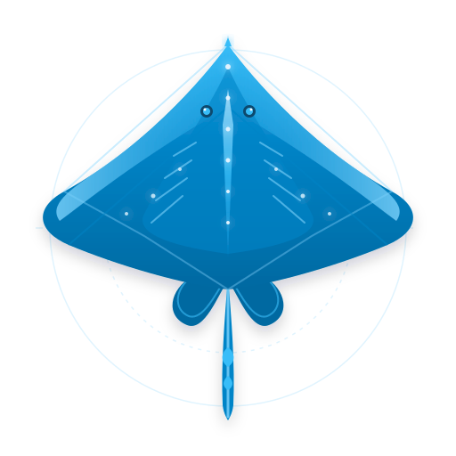
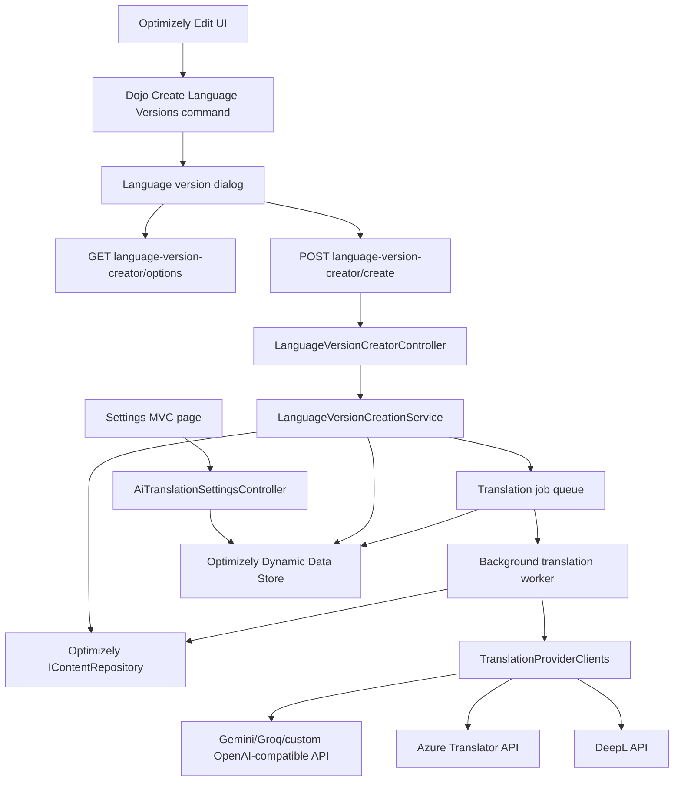

# Cheapskate.AITranslator



Optimizely CMS 13 add-on for creating draft language versions and optionally translating language-specific content with Google Gemini, GroqCloud, Azure Translator, DeepL, or a custom OpenAI-compatible provider.

## Repository scope

This README is the developer and maintainer documentation for the repository. The NuGet package ships a shorter user-facing guide from [nuget/README.md](nuget/README.md).

## Release notes

### 2.0.1

- Added support for translating `ExperienceData`, including nested `UnstructuredData`, inline blocks, and optionally linked shared content.
- This project uses AI-assisted development alongside human review, testing, and maintenance.

## Requirements and compatibility

- .NET 10.
- Optimizely CMS 13.x only. The package dependency range is `>= 13.0.0` and `< 14.0.0`.
- A CMS application with Shell UI and edit UI packages enabled.
- At least one configured site language for target language branches.
- An API key for the selected provider when AI translation is enabled.

The `main` branch and 2.x package line target CMS 13 and .NET 10. The `CMS-12-base` branch is the legacy CMS 12 line and remains on the 1.x package line with .NET 8.

## Features

- Creates draft language branches without publishing content.
- Supports all missing languages or one selected target language.
- Optionally follows linked content in `ContentArea` properties and creates/translates those branches.
- Avoids duplicate processing and protects recursive content graphs with visited-content tracking.
- Copies language-specific properties and preserves inherited properties.
- Supports Google Gemini, GroqCloud, Azure Translator, DeepL API Free, and custom OpenAI-compatible endpoints.
- Runs AI translation in a hosted background worker after draft creation.
- Batches requests using configurable input/output token limits.
- Provides localized Dojo editor UI and an icon-only toolbar command.

## Architecture



### Main components

- `Controllers/LanguageVersionCreatorController.cs`: authenticated API endpoints for localizability, options, creation, and translation status.
- `Services/LanguageVersionCreationService.cs`: resolves target cultures, creates draft branches, copies properties, optionally traverses linked content, and queues translation work.
- `Services/AiTranslationJobQueue.cs`: hosted background worker that batches work, calls providers, and writes translations back to writable content clones.
- `Services/TranslationProviderClients.cs`: provider-specific HTTP clients and the shared OpenAI-compatible chat-completions implementation.
- `Controllers/AiTranslationSettingsController.cs`: administrator settings page and provider-default handling.
- `ClientResources/commands/CreateLanguageVersionsCommand.js`: editor command and i18n-backed tooltip.
- `ClientResources/widgets/LanguageVersionCreatorDialog.js`: language selection, linked-content option, AI option, tone selection, and job polling.
- `Create-ModuleZip.ps1`: stages `module.config` and client resources into the versioned protected module ZIP.

## Function call chains

### Create language versions

```text
CreateLanguageVersionsCommand._execute()
  -> LanguageVersionCreatorDialog.show()
  -> GET /api/cheapskate/ai-translator/language-version-creator/options
  -> LanguageVersionCreatorController.GetOptions()
  -> LanguageVersionCreationService.GetLanguageOptions()

LanguageVersionCreatorDialog._onSubmit()
  -> POST /api/cheapskate/ai-translator/language-version-creator/create
  -> LanguageVersionCreatorController.Create()
  -> LanguageVersionCreationService.CreateLanguageVersionsAsync()
  -> ResolveTargetCultures()
  -> ProcessNode(root)
  -> CopyLanguageSpecificProperties()
  -> TraverseContentAreas() when IncludeLinkedContents is true
  -> IContentRepository.Save()
```

### Background AI translation

```text
CreateLanguageVersionsAsync()
  -> AiTranslationJobQueue.Enqueue()
  -> AiTranslationJobQueue background worker
  -> TranslationProviderClients.TranslateAsync()
  -> Gemini/Groq/custom chat-completions or Azure/DeepL native API
  -> parse translation response
  -> writable content clone
  -> IContentRepository.Save()
  -> dialog polls translation-status/{jobId}
```

### Settings persistence

```text
AiTranslationSettingsController.Index POST
  -> preserve masked API key when necessary
  -> AiTranslationSettings.ApplyProviderDefaults()
  -> AiTranslationSettingsService.Save()
  -> delete Dynamic Data Store
  -> recreate Cheapskate.AITranslator.Settings store
  -> save one complete settings entity
```

## Installation and user guide

Install the package into the Optimizely CMS 13 web project:

```powershell
dotnet add .\YourCmsProject.csproj package Cheapskate.AITranslator --version 2.0.1
dotnet restore .\YourCmsProject.csproj
dotnet build .\YourCmsProject.csproj
```

Restart the CMS application after installation. The package registers the protected client module and adds **AI Translator** under the CMS Settings menu.

1. Sign in as a CMS administrator and open **Settings > AI Translator**.
2. Select a provider, enter its API key, enable **AI translation**, and save.
3. Open localizable content in the editor and select the skate icon command **Create Language Versions**.
4. Choose all missing languages or one specific language.
5. Check **Include linked contents** to create and translate content referenced from `ContentArea` properties.
6. Check **Use AI translation after creating drafts** when AI translation is configured.
7. Optionally choose a translation tone and create the drafts.

Language creation always creates draft versions and never publishes content. Linked content is processed once per language when selected. AI translation runs in the background after draft creation; the dialog polls the job status and reports completion.

The NuGet package contains the shorter end-user guide from [nuget/README.md](nuget/README.md).

## Provider configuration reference

- **Google Gemini**: uses the Google OpenAI-compatible chat-completions endpoint. The model field is editable and defaults to `gemini-3.5-flash-lite`.
- **GroqCloud**: uses the OpenAI-compatible chat-completions endpoint. The model field is editable and defaults to `openai/gpt-oss-20b`.
- **Microsoft Azure Translator**: uses the native Azure Translator API and requires the Azure region.
- **DeepL API Free**: uses the native DeepL translation API.
- **Other**: configures a custom OpenAI-compatible endpoint, model, and token limits.

The model field is editable for Gemini, GroqCloud, and custom providers. **Conserve API calls** groups multiple properties into bounded JSON requests using the configured maximum input and output token limits. Provider credentials are stored in the CMS settings store and are not written to source control.

## Development

Restore with the included Optimizely feed configuration:

```powershell
dotnet restore .\src\Cheapskate.AITranslator\Cheapskate.AITranslator.csproj --configfile .\nuget.config
```

Run tests:

```powershell
dotnet test .\Cheapskate.AITranslator.sln --no-restore
```

Build the protected module ZIP:

```powershell
dotnet msbuild .\src\Cheapskate.AITranslator\Cheapskate.AITranslator.csproj /t:CheapskateCreateAddonZip /p:Configuration=Release
```

Create the NuGet package:

```powershell
dotnet pack .\src\Cheapskate.AITranslator\Cheapskate.AITranslator.csproj -c Release --configfile .\nuget.config --output .\artifacts
```

The package is built from the custom nuspec and includes the release DLL, versioned module ZIP, package README, icon, and MSBuild target that copies the module into a consuming CMS application.

## Build and compiler settings

Release builds explicitly enable:

- `Deterministic=true`
- `ContinuousIntegrationBuild=true`
- `Optimize=true`
- `DebugType=portable`
- `DebugSymbols=true`

These settings make the packaged assembly reproducible and optimized while retaining portable debugging symbols in the build output.

## Testing notes

The tests use fake HTTP responses and do not call external providers. Optional local API-key environment variables are `CHEAPSKATE_GEMINI_API_KEY`, `CHEAPSKATE_AZURE_TRANSLATOR_API_KEY`, and `CHEAPSKATE_GROQ_API_KEY`. No key is stored in the repository.

## License

Copyright (c) 2026 Linh Doan

This project is open source under the [MIT License](LICENSE).
